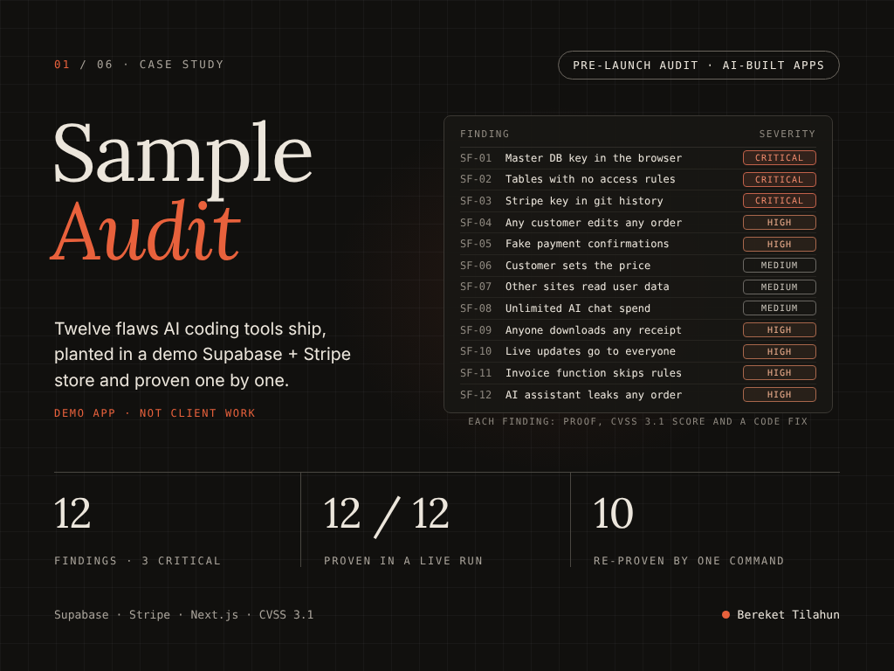

# ShopFast: intentionally vulnerable demo store

[](https://github.com/Berakhah/shopfast-demo/actions/workflows/poc.yml)



## How I'd audit your app

ShopFast is the worked example. The same review, on your Lovable, Bolt, Cursor or
Next.js + Supabase app:

1. **Scope.** You sign the [scope and authorisation form](https://berakhah.github.io/scope.html);
   nothing is tested outside it.
2. **Review.** RLS and storage policies, service-role key exposure, `SECURITY DEFINER`
   functions, webhook verification, server-trusted prices, and any AI tool that acts
   on a model-supplied id: the twelve patterns in the table below.
3. **Proof.** Every finding ships with a reproduction you can rerun and the code fix,
   scored with CVSS 3.1, in a report like
   [the ShopFast sample](docs/ShopFast-Sample-Security-Audit.pdf).

**[Hire me on Upwork](https://www.upwork.com/freelancers/~01645da719eb4829ed)** ·
[sample report (PDF)](docs/ShopFast-Sample-Security-Audit.pdf) ·
[other work](https://berakhah.github.io)

**Do not deploy this publicly. Do not reuse this code.** ShopFast is a training
fixture: a small Next.js 14 + Supabase + Stripe store with twelve security flaws
planted on purpose, each a pattern AI coding tools commonly produce. It backs the
sample findings report "Sample Security Audit: AI-Built Supabase + Stripe Store".

Every planted flaw is marked in the code with a `PLANTED SF-0n` comment.

| ID | Planted flaw | Severity (CVSS 3.1) | Where |
| --- | --- | --- | --- |
| SF-01 | Service-role key shipped to the browser | Critical (10.0) | `lib/supabase.ts` |
| SF-02 | RLS off on `profiles` and `orders` | Critical (9.1) | `supabase/migrations/` |
| SF-03 | Stripe secret key in git history (a fake test key) | Critical (9.1) | `.env`, first commit |
| SF-04 | No ownership check on orders | High (8.1) | `app/api/orders/[id]` |
| SF-05 | Stripe webhook signature never checked | High (7.5) | `app/api/stripe/webhook` |
| SF-06 | Price taken from the browser at checkout | Medium (6.5) | `app/api/checkout` |
| SF-07 | CORS reflects any origin, cookies sent cross-site | Medium (6.5) | `middleware.ts`, `lib/supabase/server.ts` |
| SF-08 | No limits on the AI chat endpoint | Medium (5.3) | `app/api/chat` |
| SF-09 | `receipts` storage bucket readable by any signed-in user | High (7.7) | `supabase/migrations/` (storage.objects policy) |
| SF-10 | `notifications` published to Realtime with an open RLS policy | High (7.7) | `supabase/migrations/` (`using (true)`) |
| SF-11 | `SECURITY DEFINER` RPC returns any invoice, bypassing RLS | High (7.7) | `supabase/migrations/` (`get_invoice`) |
| SF-12 | AI support tool acts on the model's order id, not the session user | High (7.7) | `app/api/chat` + `app/api/support` |

Severity totals across all twelve: **3 Critical, 6 High, 3 Medium.** (The new
four, SF-09..SF-12, are each `AV:N/AC:L/PR:L/UI:N/S:C/C:H/I:N/A:N` = 7.7 High:
a signed-in customer reads another customer's data across the authorization
boundary, confidentiality only.)

Stripe and OpenAI calls go to local stand-ins (`poc/standins.mjs`), so running the
proofs of concept touches no payment or AI account. The Stripe key in git history
is fake and was never valid.

**SF-12 and the scripted model.** SF-12 is a prompt-injection flaw. The OpenAI
stand-in in `poc/standins.mjs` deliberately simulates a real model that follows
instructions it finds in untrusted text (a product review) and calls the
`lookup_order` tool with the id named there. The flaw being proven is not that
the stand-in is gullible — it is that `app/api/support` runs that tool with
server privileges on the id the **model** supplies instead of the signed-in
user's own identity, so a realistic, injectable model is enough to leak another
customer's order.

## The report

The full findings report covers all twelve findings: a plain-English summary, a
CVSS 3.1 score and vector, the proof and the code fix for each, and a fix-today /
this-week / before-launch roadmap. Read it here:
[docs/ShopFast-Sample-Security-Audit.pdf](docs/ShopFast-Sample-Security-Audit.pdf).
It is also the first item in my
[Upwork portfolio](https://www.upwork.com/freelancers/~01645da719eb4829ed). The
scores in the table above are the ones in the report.

Results: 12 findings (3 Critical, 6 High, 3 Medium), all 12 demonstrated — ten
reproduced by the runner in a live CI run, SF-03 and SF-08 by the steps below.

## Run the proofs yourself

**On GitHub, no setup:** the [proofs workflow](.github/workflows/poc.yml) starts a
throwaway local Supabase stack inside the job (now including Storage and Realtime,
which SF-09 and SF-10 need), seeds two test users with their orders, receipts,
invoices and reviews, runs `npm run poc`, and fails unless SF-01, 02, 04, 05, 06,
07, 09, 10, 11 and 12 are each reproduced ([`poc/check-results.mjs`](poc/check-results.mjs)).
It runs on every push and weekly, uses no repository secrets, and keeps the
redacted results as a download on each run.

Two findings are not reproduced by the runner, because each is best shown outside
the app's request flow:

- **SF-03 (Stripe secret key in git history)** — shown by these exact steps, not a
  script. The first commit added a `.env` (removed in the next commit), so the key
  is still in history:
  ```sh
  git log --diff-filter=A --oneline -- .env      # 8cb6026 Initial ShopFast export
  git show 8cb6026:.env | grep STRIPE_SECRET_KEY  # prints the fake sk_test_… key
  ```
  Run from a fresh clone, these print the key straight out of history. The key is a
  fake test key and was never valid.
- **SF-08 (no limits on the AI chat endpoint)** — shown by [`poc/sf08.sh`](poc/sf08.sh),
  which fires 200 unauthenticated POSTs at `/api/chat` and tallies the HTTP codes
  (all `200`, no login, no rate limit). When `npm run poc` is running the stack it
  can be run against it directly: `BASE=http://localhost:3000 bash poc/sf08.sh`. The
  OpenAI stand-in logs every call it received to `poc/out/openai-requests.log`, which
  is where that proof's output lives (one line per forwarded request, showing there
  is no cap).

**On your machine:** needs Node 20+, Docker and the
[Supabase CLI](https://supabase.com/docs/guides/local-development).

1. `supabase init && supabase start` (applies `supabase/migrations/` to a local
   stack), then `supabase status -o env > supabase.env`.
2. `node poc/ci-env.mjs supabase.env > .env.local`. This writes the Supabase URL and
   keys, the planted `NEXT_PUBLIC_SUPABASE_SERVICE_ROLE_KEY` (SF-01), a test
   password, and the settings that point Stripe and OpenAI at the local stand-ins.
3. `npm install`, then `node poc/ci-seed.mjs` (creates Alice, Bob, orders 1041
   and 1042, Alice's receipt and invoice, and the injected product review).
4. `npm run poc`, then `node poc/check-results.mjs`. Redacted output is in
   `poc/out/results.txt`.

`supabase stop` when you're done. Don't point this at a hosted project: with these
flaws it is open to anyone who has its URL.

## Get your own app audited

See [How I'd audit your app](#how-id-audit-your-app) above, or
[hire me on Upwork](https://www.upwork.com/freelancers/~01645da719eb4829ed).
